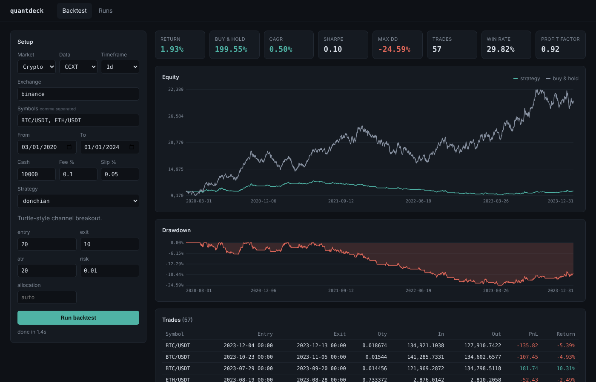

# quantdeck

Backtesting, paper trading and live trading for US stocks and crypto, in Python.

The same strategy code runs in all three modes. A backtest uses a local
matching engine; paper and live trading go through Alpaca (stocks and crypto)
or any exchange supported by [CCXT](https://github.com/ccxt/ccxt) (Binance,
OKX, Bybit and so on). A small web dashboard runs backtests and shows what the
paper and live runs are doing.



<sub>Screenshot uses demo data.</sub>

## Features

- Event-driven backtester: orders fill on the next bar, so a strategy can't trade on the bar it used to decide
- Fees, slippage, whole-share vs fractional sizing, limit and stop orders
- Metrics: CAGR, Sharpe, Sortino, max drawdown, win rate, profit factor, exposure, plus an equal-weight buy & hold comparison
- Paper trading three ways: Alpaca paper account, exchange testnet or demo, or fully local (live prices, simulated fills, no account needed)
- Live trading with a pre-trade risk layer: order size, position size, gross exposure and daily loss limits, plus a kill switch
- Parquet cache for historical data, so repeat backtests work offline
- Web dashboard and JSON API

## Install

```bash
git clone https://github.com/haoyu1zhang/quantdeck.git
cd quantdeck
python -m venv .venv && source .venv/bin/activate
pip install -e ".[all,dev]"
```

Python 3.10+. `[all]` pulls in `alpaca-py` and `ccxt`; install `.[alpaca]` or
`.[crypto]` if you only need one.

## Quick start

```bash
quantdeck strategies                               # list built-in strategies
quantdeck backtest examples/btc_sma_backtest.yaml  # downloads BTC/ETH daily bars from Binance
quantdeck serve                                    # dashboard on http://127.0.0.1:8000
```

Backtest results go to `runs/<name>/backtest/` (equity curve, trades,
metrics).

Crypto data from CCXT needs no account. Stock data comes from Alpaca and
needs API keys, but a free paper account is enough.

## API keys

Copy `.env.example` to `.env` and fill in what you use:

```
ALPACA_API_KEY=...
ALPACA_SECRET_KEY=...
BINANCE_API_KEY=...
BINANCE_SECRET=...
```

CCXT keys follow `<EXCHANGE>_API_KEY` / `<EXCHANGE>_SECRET`, plus
`<EXCHANGE>_PASSWORD` for exchanges that use a passphrase (OKX).

For exchange keys used by a bot: turn off withdrawal permission and restrict
the key to your server's IP.

## Paper and live trading

```bash
quantdeck run examples/local_paper.yaml          # no account needed
quantdeck run examples/btc_paper_testnet.yaml    # Binance spot testnet
quantdeck run examples/stocks_paper_alpaca.yaml  # Alpaca paper
quantdeck run examples/live_alpaca.yaml --confirm-live
```

What the runner does:

1. Loads `data.warmup` bars of history so indicators are ready, without trading.
2. Reads current positions and open orders from the broker, so a restart picks up where it left off.
3. Polls every `poll_seconds`. When a bar closes, the strategy sees it. Bars that are still forming are ignored.
4. Writes `status.json`, `equity.csv`, `journal.jsonl` (every order and fill) and `run.log` to `runs/<name>/`.

To stop a run, press Ctrl+C, click Stop in the dashboard, or create
`runs/<name>/STOP`. Open orders are canceled on the way out.

US stock runs only act during the regular session. The runner asks Alpaca's
clock, which knows about holidays and half days.

### Safety rails

- `mode: live` won't start without `--confirm-live`
- `mode: live` with a CCXT broker refuses to start if `sandbox` or `demo` is still on
- Risk checks run before every order. Orders that reduce a position always go through, even after a halt
- `max_daily_loss_pct` halts new entries for the rest of the day
- Ten loop errors in a row halt new entries
- A pid lock stops the same run from being started twice

## Config reference

```yaml
name: my-run              # also the folder under runs/
mode: backtest            # backtest | paper | live
market: crypto            # crypto | stock
symbols: [BTC/USDT]
cash: 10000               # backtests and local paper
fractional: true          # false = whole shares
poll_seconds: 30

broker:
  type: sim               # sim | alpaca | ccxt
  exchange: binance       # ccxt only
  sandbox: true           # exchange testnet
  demo: false             # exchange demo trading (Bybit, OKX demo with live keys)

data:
  source: ccxt            # ccxt | alpaca | csv
  exchange: binance
  timeframe: 1h           # 1m 5m 15m 1h 4h 1d ...
  start: "2022-01-01"
  end: "2024-01-01"
  path: data/             # csv: a file, or a folder with one <SYMBOL>.csv each
  warmup: 200

fees:
  rate: 0.001             # fraction of notional
  per_share: 0.0
  minimum: 0.0
  slippage: 0.0005

risk:
  max_order_value: 1000
  max_position_pct: 0.5
  max_gross_exposure: 1.0
  max_daily_loss_pct: 0.03
  max_orders_per_day: 20
  allow_short: false

strategy:
  name: sma_cross
  params: {fast: 20, slow: 50}
```

## Writing a strategy

```python
from quantdeck.strategies import Strategy


class Breakout(Strategy):
    params = {"lookback": 20}

    def on_bar(self, ctx, bar):
        if ctx.bars(bar.symbol) <= self.p.lookback:
            return
        highs = ctx.highs(bar.symbol, self.p.lookback + 1)[:-1]
        if bar.close > highs.max() and ctx.position(bar.symbol) == 0:
            ctx.order_target_percent(bar.symbol, 0.5)
        elif bar.close < ctx.closes(bar.symbol, 10).mean():
            ctx.close_position(bar.symbol)
```

Reference it from a config as `name: mypackage.mymodule:Breakout`.
`examples/my_strategy.py` has a full multi-symbol example.

What `ctx` gives you:

| | |
|---|---|
| `closes / highs / lows(sym, n)` | numpy arrays of the last n bars |
| `history(sym, n)` | the same as a DataFrame |
| `price(sym)`, `bars(sym)` | last close, bars seen so far |
| `position(sym)`, `positions()`, `equity`, `cash` | portfolio state |
| `buy / sell(sym, qty, limit=, stop=)` | raw orders |
| `order_target_qty / order_target_percent(sym, x)` | trade toward a target, counting orders that are still open |
| `close_position(sym)`, `cancel_all(sym=None)` | |
| `state` | a dict for anything the strategy wants to keep |

Built-in strategies: `sma_cross`, `rsi_reversion`, `donchian`. They are
examples, not recommendations.

## How it's put together

```
strategy  ->  Context  ->  RiskManager  ->  Broker
                                             |- SimBroker     (backtest, local paper)
                                             |- AlpacaBroker  (paper / live)
                                             '- CcxtBroker    (testnet / demo / live)
```

The strategy only talks to `Context`. It never touches a broker directly,
which is what makes the same code run in every mode.

### Concurrency

- **Market data.** The runner fetches all symbols in parallel from a bounded thread pool. One slow endpoint doesn't hold up the others.
- **Rate limits.** Every venue client is wrapped in a thread-safe token bucket (Alpaca: 3 req/s; CCXT: the exchange's own limit). Threads sharing a client share the budget.
- **Order placement.** Strategy callbacks and orders stay on one thread, in timestamp order, so a fill can't arrive halfway through a decision. Each order carries a unique client order id. On a timeout the broker looks the order up by that id before retrying, so a lost response doesn't turn into a second order.
- **Multiple processes.** Each run takes a pid lock, so the same config can't be started twice. Give each concurrently running strategy its own account or sub-account. Risk limits are per process and don't see each other's positions.
- **Dashboard.** Backtests run in a process pool behind a job queue. The API stays responsive, identical requests share one job and its cached result, and the queue is capped (HTTP 429 when full). Status files are written atomically, so the dashboard never reads half a file.

## Project layout

```
src/quantdeck/
  backtest/      engine and metrics
  brokers/       sim, alpaca, ccxt
  data/          sources (ccxt, alpaca, csv) and parquet cache
  live/          runner, market clock, run lock
  strategies/    base class and built-ins
  api/           FastAPI app and backtest job queue
  web/           dashboard (plain HTML/JS, no build step)
  context.py     what strategies see
  risk.py        pre-trade checks
  ratelimit.py   token bucket, throttled clients, retry
examples/        configs and a custom strategy
tests/
```

## Tests

```bash
pytest -q
```

No network needed. Broker adapters are tested against fake clients.

## Known limitations

- Spot only on CCXT, no futures or margin yet
- Backtests use bar data, so intrabar order of high and low is unknown. A bar that touches both a limit and a stop fills both
- Stock data defaults to Alpaca's free IEX feed, which covers a slice of total volume
- Average entry price for spot crypto is tracked locally and resets to market price after a restart

## Disclaimer

This is software, not financial advice. Backtests overstate what you'll get
live. Run anything new on paper first, then with small size. You're
responsible for what you trade.

## License

MIT
