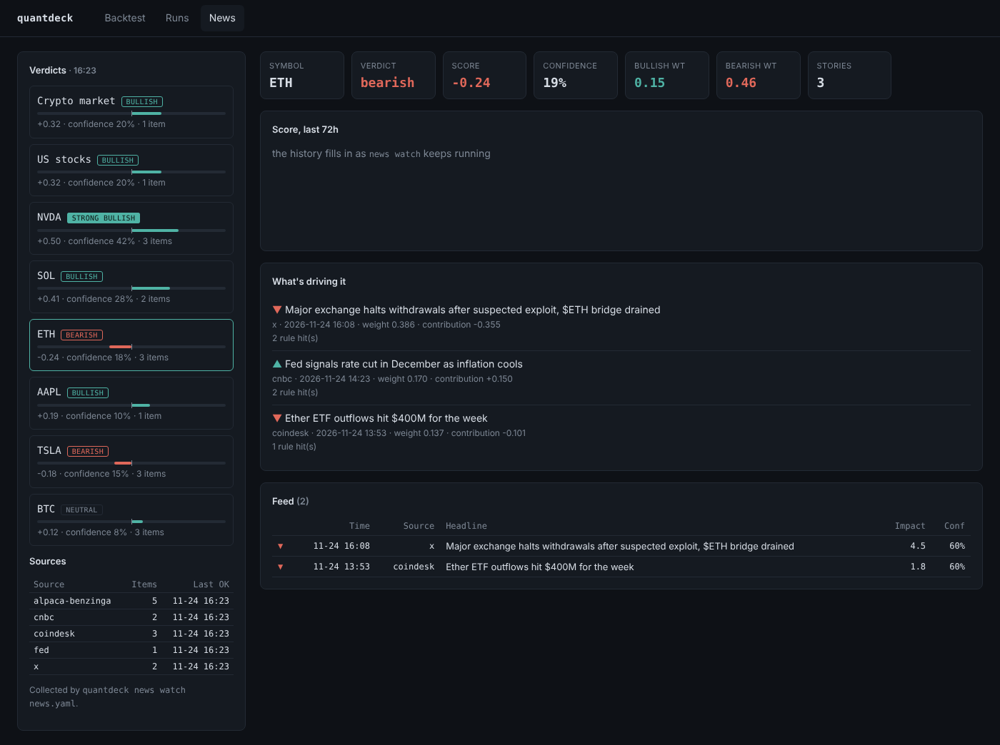

# quantdeck

Backtesting, paper trading and live trading for US stocks and crypto, in Python.

The same strategy code runs in all three modes. A backtest uses a local
matching engine; paper and live trading go through Alpaca (stocks and crypto)
or any exchange supported by [CCXT](https://github.com/ccxt/ccxt) (Binance,
OKX, Bybit and so on). A small web dashboard runs backtests and shows what the
paper and live runs are doing.


<sub>Screenshot uses demo data.</sub>

## Features

- Event-driven backtester: orders fill on the next bar, so a strategy can't trade on the bar it used to decide. Roughly 45k bars a second on one core with a simple strategy
- Fees, slippage, volume caps, whole-share vs fractional sizing, limit and stop orders
- Metrics: CAGR, Sharpe, Sortino, max drawdown, win rate, profit factor, exposure, plus an equal-weight buy & hold comparison
- Grid search across processes, and walk-forward testing to see how parameters hold up on data they weren't picked on
- Paper trading three ways: Alpaca paper account, exchange testnet or demo, or fully local (live prices, simulated fills, no account needed)
- Live trading with a pre-trade risk layer: order size, position size, gross exposure and daily loss limits, plus a kill switch
- Stop-loss / take-profit orders that rest at the broker, so positions stay protected if the bot goes down
- Telegram, webhook (Slack, Discord, WeCom, Feishu, DingTalk) and email alerts, plus a watchdog for runs that stop responding
- News feed with a bullish / bearish verdict per symbol: RSS, Alpaca (Benzinga), SEC filings, Reddit, CryptoPanic, X and anything you push in, scored by an LLM with a rule-based fallback, and an optional gate that blocks new entries on strongly negative news
- Runs recorded in SQLite; dashboard with token login; Docker setup

## Install

```bash
git clone https://github.com/haoyu1zhang/quantdeck.git
cd quantdeck
python -m venv .venv && source .venv/bin/activate
pip install -e ".[all,dev]"
```

Python 3.10+. `[all]` pulls in `alpaca-py` and `ccxt`; install `.[alpaca]` or
`.[crypto]` if you only need one.

## Quick start

```bash
quantdeck strategies                               # list built-in strategies
quantdeck backtest examples/btc_sma_backtest.yaml  # downloads BTC/ETH daily bars from Binance
quantdeck serve                                    # dashboard on http://127.0.0.1:8000
```

Backtest results go to `runs/<name>/backtest/` (equity curve, trades,
metrics).

Crypto data from CCXT needs no account. Stock data comes from Alpaca and
needs API keys, but a free paper account is enough.

## API keys

Copy `.env.example` to `.env` and fill in what you use:

```
ALPACA_API_KEY=...
ALPACA_SECRET_KEY=...
BINANCE_API_KEY=...
BINANCE_SECRET=...
```

CCXT keys follow `<EXCHANGE>_API_KEY` / `<EXCHANGE>_SECRET`, plus
`<EXCHANGE>_PASSWORD` for exchanges that use a passphrase (OKX).

For exchange keys used by a bot: turn off withdrawal permission and restrict
the key to your server's IP.

## Paper and live trading

```bash
quantdeck run examples/local_paper.yaml          # no account needed
quantdeck run examples/btc_paper_testnet.yaml    # Binance spot testnet
quantdeck run examples/stocks_paper_alpaca.yaml  # Alpaca paper
quantdeck run examples/live_alpaca.yaml --confirm-live
```

What the runner does:

1. Loads `data.warmup` bars of history so indicators are ready, without trading.
2. Reads current positions and open orders from the broker, so a restart picks up where it left off.
3. Polls every `poll_seconds`. When a bar closes, the strategy sees it. Bars that are still forming are ignored.
4. Writes `status.json`, `equity.csv`, `journal.jsonl` (every order and fill) and `run.log` to `runs/<name>/`.

To stop a run, press Ctrl+C, click Stop in the dashboard, or create
`runs/<name>/STOP`. Working entry orders are canceled on the way out;
protective stops stay at the broker.

US stock runs only act during the regular session. The runner asks Alpaca's
clock, which knows about holidays and half days.

### Protective exits

```yaml
risk:
  stop_loss_pct: 0.05
  take_profit_pct: 0.15
  trailing_stop: true
```

As soon as a position is open, a stop order goes to the broker for the full
size, so it executes even if quantdeck has crashed or the server is offline.
It's kept in sync as the position changes, moved up when `trailing_stop` is
on, and canceled when the strategy exits on its own.

How the take-profit is placed depends on the venue:

| | stop | take-profit |
|---|---|---|
| Alpaca stocks, whole shares | stop | same order (OCO) |
| Alpaca stocks, fractional | stop (DAY, re-placed each session) | watched by quantdeck |
| Alpaca crypto | stop-limit, 1% below the stop | watched by quantdeck |
| CCXT spot | stop (`triggerPrice`) | watched by quantdeck |
| backtest / local paper | stop | same order (OCO) |

### Notifications

Set any of these in `.env` and they're used automatically:

```
TELEGRAM_BOT_TOKEN=...   TELEGRAM_CHAT_ID=...
NOTIFY_WEBHOOK_URL=...   NOTIFY_WEBHOOK_KIND=wecom   # slack, discord, feishu, dingtalk
SMTP_HOST=...            NOTIFY_EMAIL_TO=...
```

`quantdeck notify-test` sends a test message. Runs report start, stop, fills,
stop-loss hits, halts and errors; repeated errors are rate-limited. Pick events
per run with `notify.events`, or set `notify.telegram: true` to refuse to
start without it.

A crashed process can't send its own alert, so run the watchdog next to your
bots:

```bash
quantdeck watchdog --stale 600   # alert when a run's heartbeat is 10 minutes old
```

### Safety rails

- `mode: live` won't start without `--confirm-live`
- `mode: live` with a CCXT broker refuses to start if `sandbox` or `demo` is still on
- Risk checks run before every order, counting orders that are still open. Orders that reduce a position always go through, even after a halt
- `max_daily_loss_pct` halts new entries for the rest of the day (New York trading day for stocks, UTC day for crypto)
- Ten loop errors in a row halt new entries
- A pid lock stops the same run from being started twice

## News and sentiment

`quantdeck news` collects headlines and posts about your watchlist, rates
each one, and rolls them up into a verdict per symbol: strong bearish,
bearish, neutral, bullish or strong bullish, with a score from -1 to 1 and
a confidence.

```bash
quantdeck news fetch examples/news.yaml            # one pass over every source, prints verdicts
quantdeck news watch examples/news.yaml            # keep going; alerts on strong verdicts
quantdeck news report examples/news.yaml --symbol NVDA --lang zh
quantdeck serve --news-config examples/news.yaml   # News tab, with a refresh button and manual adds
```

You don't have to keep `news watch` running. Start the dashboard with
`--news-config` and use **Refresh now** in the News tab whenever you want a
fresh pass, and **Add a post or headline** to paste in something you saw
(an X post, a Telegram message, a headline from a paid terminal). Pasted
items go through the same tagging and scoring as everything else.



<sub>Screenshot uses demo headlines.</sub>

### Sources

| type | what | needs |
|---|---|---|
| `rss` | any RSS or Atom feed; `{symbol}` / `{query}` in the URL fetches it per symbol (Yahoo Finance, Google News) | nothing |
| `alpaca` | Alpaca's news API, which carries the Benzinga wire | Alpaca keys (a free paper account works) |
| `sec` | 8-K filings for each stock, with the item numbers spelled out | `SEC_USER_AGENT` (name and email) |
| `reddit` | new posts from the subreddits you list | optional `REDDIT_CLIENT_ID` / `_SECRET` |
| `cryptopanic` | crypto news with reader votes | `CRYPTOPANIC_TOKEN` |
| `twitterapi_io` | X posts through TwitterAPI.io (cashtags, accounts, custom queries), about $0.15 per 1,000 posts | `TWITTERAPI_IO_KEY` |
| `x` | the same searches through X's official API v2, pay per use at about $5 per 1,000 posts | `X_BEARER_TOKEN` |
| `jsonl` | JSON lines dropped into a folder | nothing |
| `pkg.module:Class` | your own subclass of `quantdeck.news.sources.Source` | |

Every source has its own polling interval (`every`, minutes). A failing
source is logged and skipped; the others carry on. Both X sources take
`daily_limit`, a cap on posts read per UTC day, since busy cashtags like
`$BTC` or `$NVDA` produce far more posts than are worth paying for.

To plug in a collector of your own (a different X client, Telegram
channels, a paid data feed), either write a `Source` subclass or post items
to the dashboard server:

```bash
curl -X POST http://127.0.0.1:8000/api/news/ingest -H 'Content-Type: application/json' \
  -d '{"items": [{"title": "$NVDA wins Pentagon contract", "kind": "social", "credibility": 0.5,
                  "engagement": {"likes": 900, "reposts": 120}}]}'
```

They're picked up on the next `news watch` cycle and handled like
everything else.

### Scoring

Each item is tagged with the watchlist symbols it mentions (cashtags,
tickers, company and coin names), grouped with near-identical headlines
from other outlets, and scored:

- **LLM** (`llm.provider: auto`): Claude with `ANTHROPIC_API_KEY`, or any
  OpenAI-compatible API with `OPENAI_API_KEY`, or `NEWS_LLM_API_KEY` plus
  `NEWS_LLM_BASE_URL` (DeepSeek, Qwen, a local model). Items go in batches;
  the model returns direction (-1..1), impact (1-5), confidence, horizon,
  and whether the item is about specific assets, a whole market, or the
  macro picture.
- **Rules**: about 70 finance-specific phrases (beats/misses, guidance,
  downgrades, hacks, ETF approvals, rate decisions, Chinese headlines ...).
  Used on their own without an LLM key, as the fallback when a call fails,
  and as a cross-check: a strong rule pointing the other way lowers the
  LLM's confidence.

Each item then gets a weight:

```
weight = credibility × impact × confidence × recency × engagement × corroboration
```

| factor | |
|---|---|
| credibility | by source kind: official 1.0, filing 0.9, newswire 0.85, media 0.65, social 0.3. Override per source; for X it's per author, from followers and verification, with a `trusted:` list for official accounts |
| impact, confidence | from the scorer |
| recency | halves every 4h / 24h / 96h for intraday / days / weeks news |
| engagement | up to ×1.6 from likes, reposts, replies and votes (social only) |
| corroboration | up to ×1.75 when several different sources carry the story |

A story syndicated to twenty sites counts once, with the corroboration
bonus. Market-wide and macro items (Fed, CPI, tariffs, crypto regulation)
feed `MARKET:stock` / `MARKET:crypto` and count toward every symbol in that
market at `macro_beta` (0.5).

```
score = Σ(weight × direction) / (Σ weight + prior)
```

The prior keeps the score near zero when there's little news, so one
headline doesn't flip a symbol to strong bearish. Confidence combines how
much the evidence agrees with how much of it there is. Labels use
`thresholds` (strong at ±0.45, weak at ±0.15).

### Using it in a strategy

Point a paper or live config at the news database:

```yaml
news:
  db: runs/news/news.db
  max_age_minutes: 60        # verdicts older than this count as none
  block_longs_below: -0.45   # optional: refuse new longs on strong bearish news
  block_shorts_above: 0.45   # optional: refuse new shorts on strong bullish news
```

The gate only stops orders that open or add to a position; exits and stops
always go through. Strategies can also read verdicts directly:

```python
def on_bar(self, ctx, bar):
    if ctx.news_score(bar.symbol) < -0.3:
        return
    v = ctx.news("MARKET:crypto")   # dict with score, label, confidence, drivers; None if unavailable
```

Backtests have no news (`ctx.news` returns None, `news_score` the default),
because there is no point-in-time archive to replay. Treat the verdicts as
a filter you've watched on paper for a while, not as a backtested signal.

## Finding parameters without fooling yourself

```bash
# every combination, ranked (in-sample only)
quantdeck optimize examples/btc_sma_backtest.yaml --grid fast=10:50:10 --grid slow=50,100,150,200

# walk-forward: choose on one window, score on the next, four times over
quantdeck optimize examples/btc_sma_backtest.yaml --grid fast=10:50:10 --grid slow=50,100,150,200 \
    --walk-forward 4 --train-frac 0.7
```

The walk-forward report shows the parameters each window picked, how they did
on the following unseen window, and the stitched out-of-sample equity curve.
Walk-forward efficiency (out-of-sample Sharpe over in-sample Sharpe) is the
number to look at: well below 0.5 usually means the grid search was fitting
noise. Results go to `runs/<name>/optimize/`.

## Config reference

```yaml
name: my-run              # also the folder under runs/
mode: backtest            # backtest | paper | live
market: crypto            # crypto | stock
symbols: [BTC/USDT]
cash: 10000               # backtests and local paper
fractional: true          # false = whole shares
poll_seconds: 30

broker:
  type: sim               # sim | alpaca | ccxt
  exchange: binance       # ccxt only
  sandbox: true           # exchange testnet
  demo: false             # exchange demo trading (Bybit, OKX demo with live keys)

data:
  source: ccxt            # ccxt | alpaca | csv
  exchange: binance
  timeframe: 1h           # 1m 5m 15m 1h 4h 1d ...
  start: "2022-01-01"
  end: "2024-01-01"
  path: data/             # csv: a file, or a folder with one <SYMBOL>.csv each
  warmup: 200

fees:
  rate: 0.001             # fraction of notional
  per_share: 0.0
  minimum: 0.0
  slippage: 0.0005
  max_volume_pct: 0.05    # backtest: fill at most 5% of a bar's volume, rest carries over

risk:
  max_order_value: 1000
  max_position_pct: 0.5
  max_gross_exposure: 1.0
  max_daily_loss_pct: 0.03
  max_orders_per_day: 20
  allow_short: false
  stop_loss_pct: 0.05
  take_profit_pct: 0.15
  trailing_stop: false

notify:
  telegram: null          # null: use if configured, true: required, false: off
  webhook: null           # or the format: slack | discord | wecom | feishu | dingtalk
  email: null
  events: [start, stop, fill, stop_hit, halt, error]

strategy:
  name: sma_cross
  params: {fast: 20, slow: 50}

news:                     # paper / live only, see "News and sentiment"
  db: null
  max_age_minutes: 60
  block_longs_below: null
  block_shorts_above: null
```

## Writing a strategy

```python
from quantdeck.strategies import Strategy


class Breakout(Strategy):
    params = {"lookback": 20}

    def on_bar(self, ctx, bar):
        if ctx.bars(bar.symbol) <= self.p.lookback:
            return
        highs = ctx.highs(bar.symbol, self.p.lookback + 1)[:-1]
        if bar.close > highs.max() and ctx.position(bar.symbol) == 0:
            ctx.order_target_percent(bar.symbol, 0.5)
        elif bar.close < ctx.closes(bar.symbol, 10).mean():
            ctx.close_position(bar.symbol)
```

Reference it from a config as `name: mypackage.mymodule:Breakout`.
`examples/my_strategy.py` has a full multi-symbol example.

What `ctx` gives you:

| | |
|---|---|
| `closes / highs / lows(sym, n)` | numpy arrays of the last n bars |
| `history(sym, n)` | the same as a DataFrame |
| `price(sym)`, `bars(sym)` | last close, bars seen so far |
| `position(sym)`, `positions()`, `equity`, `cash` | portfolio state |
| `buy / sell(sym, qty, limit=, stop=)` | raw orders |
| `order_target_qty / order_target_percent(sym, x)` | trade toward a target, counting orders that are still open and the cash pending sells will free up |
| `close_position(sym)`, `cancel_all(sym=None)` | |
| `vol_target_weight(sym, target_vol)` | weight that gives a symbol roughly that annualised volatility |
| `state` | a dict for anything the strategy wants to keep |

Built-in strategies: `sma_cross`, `rsi_reversion`, `donchian`. They are
examples, not recommendations.

## How it's put together

```
strategy  ->  Context  ->  RiskManager  ->  Broker
                                             |- SimBroker     (backtest, local paper)
                                             |- AlpacaBroker  (paper / live)
                                             '- CcxtBroker    (testnet / demo / live)
```

The strategy only talks to `Context`. It never touches a broker directly,
which is what makes the same code run in every mode.

### Concurrency

- **Market data.** The runner fetches all symbols in parallel from a bounded thread pool. One slow endpoint doesn't hold up the others.
- **Rate limits.** Every venue client is wrapped in a thread-safe token bucket (Alpaca: 3 req/s; CCXT: the exchange's own limit). Threads sharing a client share the budget.
- **Order placement.** Strategy callbacks and orders stay on one thread, in timestamp order, so a fill can't arrive halfway through a decision. Each order carries a unique client order id. On a timeout the broker looks the order up by that id before retrying, so a lost response doesn't turn into a second order.
- **Multiple processes.** Each run takes a pid lock, so the same config can't be started twice. Give each concurrently running strategy its own account or sub-account. Risk limits are per process and don't see each other's positions.
- **Dashboard.** Backtests run in a process pool behind a job queue. The API stays responsive, identical requests share one job and its cached result, and the queue is capped (HTTP 429 when full). Status files are written atomically, and the trade database runs in WAL mode, so the dashboard reads while the runner writes without either waiting.
- **Notifications** go out from a background thread with a bounded queue. A slow chat API never delays an order.
- **Optimisation** spreads combinations over a process pool. The data is handed to each worker once, not with every task.

## Deploying

```bash
cp .env.example .env            # keys, QUANTDECK_TOKEN, notification settings
mkdir configs && cp examples/btc_paper_testnet.yaml configs/bot.yaml
docker compose up -d            # dashboard, one bot, watchdog
```

For the news collector, copy `examples/news.yaml` to `configs/news.yaml` and
start it with `docker compose --profile news up -d`. To refresh by hand from
the dashboard instead, set `QUANTDECK_NEWS_CONFIG=configs/news.yaml` in `.env`. The dashboard's News tab
and any bot with `news.db: runs/news/news.db` read from the same database.

The dashboard is bound to 127.0.0.1 on the host. To reach it from elsewhere,
put a reverse proxy with TLS in front of it. `quantdeck serve` won't listen on
a public address unless `QUANTDECK_TOKEN` is set. Each bot is its own service,
restarted automatically and stopped with time to cancel working orders.

Each run writes to `runs/<name>/`:

| file | |
|---|---|
| `status.json` | current state, read by the dashboard and the watchdog |
| `trades.db` | SQLite: orders, fills, equity curve |
| `journal.jsonl` | append-only log of every order and fill |
| `run.log` | the process log |
| `sim_state.json` / `broker_state.json` | what's needed to resume after a restart |

## Project layout

```
src/quantdeck/
  backtest/      engine, metrics, grid search and walk-forward
  brokers/       sim, alpaca, ccxt
  data/          sources (ccxt, alpaca, csv) and parquet cache
  live/          runner, market clock, run lock, watchdog
  news/          news sources, dedup, LLM and rule scoring, verdicts
  strategies/    base class and built-ins
  api/           FastAPI app and backtest job queue
  web/           dashboard (plain HTML/JS, no build step)
  context.py     what strategies see
  risk.py        pre-trade checks
  ratelimit.py   token bucket, throttled clients, retry
  notify.py      Telegram / webhook / email alerts
  storage.py     SQLite trade store
examples/        configs and a custom strategy
tests/
```

## Tests

```bash
pytest -q                  # offline; broker adapters run against fake clients
pytest -m integration -rs  # real round trips on Binance testnet and Alpaca paper
```

The integration tests place limit orders far from the market and cancel them.
They need `BINANCE_TESTNET_API_KEY` / `BINANCE_TESTNET_SECRET` and Alpaca paper
keys, and skip whatever isn't configured. In CI they run when the same names
are added as repository secrets (Alpaca as `ALPACA_PAPER_API_KEY` /
`ALPACA_PAPER_SECRET_KEY`). GitHub's runners are in the US, so testnets that
block US traffic will fail there.

## Known limitations

- Spot only on CCXT, no futures or margin yet
- Market data is polled, not streamed. Fine for 5-minute bars and up; too slow for anything that needs to react within seconds
- Backtests use bar data, so the order of high and low inside a bar is unknown. When a bar reaches both a stop and its take-profit, the stop is assumed to fill
- Stock data defaults to Alpaca's free IEX feed, which covers a slice of total volume
- News verdicts can't be backtested, and the rule scorer reads headlines literally. Headlines also tend to arrive after the price has moved
- Risk limits are per process. Strategies sharing one account don't see each other's positions

## Disclaimer

This is software, not financial advice. Backtests overstate what you'll get
live. Run anything new on paper first, then with small size. You're
responsible for what you trade.

## License

MIT
